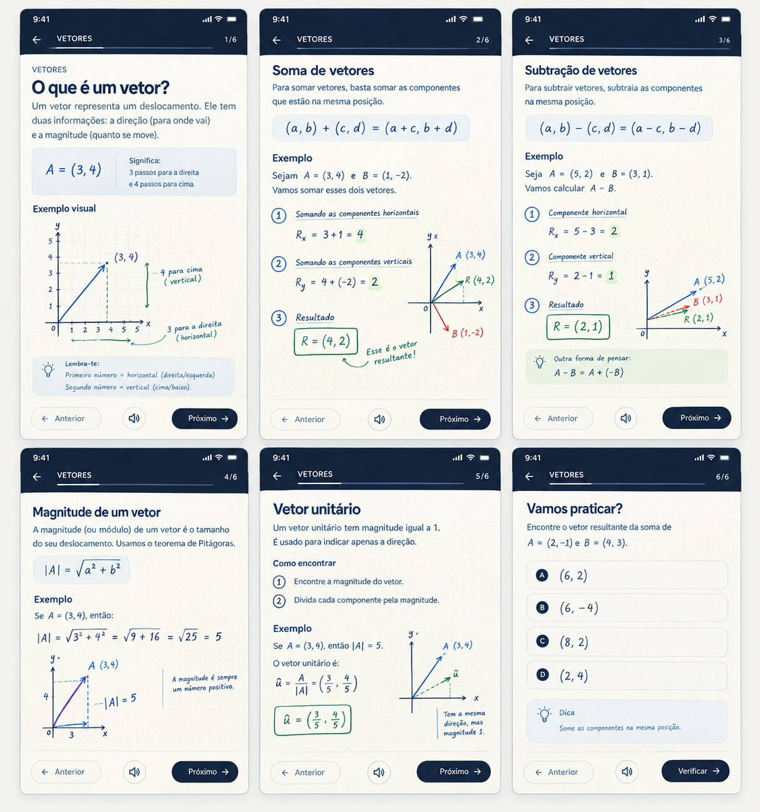

# Ingenium — Site-wide Learning Experience Direction

**Status:** Direction agreed. The warm visual system and reusable four-stage lesson shell have been implemented as the Phase 2 foundation. This is **not** the completed pedagogical rollout: the current lessons still reuse their existing copy and examples, and the upcoming reference-lesson work must refine the teaching sequence and visuals topic by topic.

## Current implementation checkpoint — 2026-10-12

- **Complete:** shared warm-paper/navy/soft-blue/sage styling; light formula surface; responsive lesson header and stage progress; consistent back/audio/next controls; saved stage position; Portuguese/English stage labels and narration language.
- **Preserved:** the existing dotted-paper Mathematics canvas and its step controls, the Physics guided-step panel, lesson practice/answer state, completion, route structure, and global bottom navigation on non-lesson routes. On narrow lesson screens, the global bar is hidden contextually so it cannot cover the lesson controls; the lesson header back control remains available.
- **Validated:** all 26 lesson routes were advanced through the four shell stages at 390px; Math canvas and Physics step panels remained interactive; representative English routes and 360px/1440px layouts were checked with no page errors or horizontal overflow. On a phone, the lesson Next button is clear of the site-wide bottom bar; keyboard Next/audio work, and the global bar returns after leaving the lesson.
- **Still pending:** topic-specific idea/visual/example/rule/practice sequencing, new or refined instructional diagrams, lesson-copy and mathematical/physical review, stronger misconception feedback, and the reference-lesson pilot. Do not treat the shell alone as evidence that every lesson is now easy to understand.

The current four-stage shell is a deliberately low-credit scaffold over existing content. Future agents may split or combine stages per topic; do not force every lesson into four identical screens.

## Product goal

Make Ingenium feel like a calm, natural, guided learning experience—not a long dashboard page with lesson content stacked into unrelated cards. Across **all Mathematics and Physics topics**, explain one idea at a time, show why each step follows, and make the next action obvious.

Use the user-provided six-screen Vectors storyboard as the visual and pacing reference: a learner progresses through a coherent set of focused screens, from the meaning of a concept to examples and practice. Borrow its clarity, sequence, and visual warmth, not its exact wording or a vectors-only structure.

Lessons may become longer when that extra space makes the reasoning understandable. Keep each screen focused and make progress through the lesson visible, so more explanation feels guided rather than like an endless page.

## Visual reference committed with this direction

The image above is stored in this repository at `settings/references/guided-vector-lesson-reference.png`. It is the concrete visual north star for the next learning-experience pass. Read it as a sequence: explain the idea, unpack the notation, show a useful relationship, work through a labelled visual example in small steps, then offer practice. Its six panels are a pacing/layout example—not a required six-screen template, and not a signal that only Vectors should change. Apply the same clarity and warm visual language across every Mathematics and Physics topic, using each topic's own best explanation and diagram.

## Principles that must remain true

- Keep Ingenium's existing course, subject tracks, topics, and recognizable identity.
- **Keep the existing hand-drawn canvas/doodles.** Refine them and place them beside the reasoning they clarify; do not remove the canvas or replace it with generic diagrams.
- Preserve the essential product capabilities: Portuguese/English, progress and completion, lesson practice and answer feedback, question doodle where useful, formula triangles where useful, audio where available, mini-test, and clear lesson navigation.
- Adapt the visual explanation to the subject. Do not make every topic imitate vectors or force a doodle where it adds no meaning.
- Keep the interface uncluttered, mobile-first, accessible, and consistent across lessons.
- **Spend credits carefully:** prefer the existing content, CSS, SVG/canvas, and reusable components. Do not depend on AI image generation, repeated large model calls, or a new service to implement this direction.

## Reference lesson rhythm

Treat a topic as a short guided sequence of purposeful screens. The exact number of screens depends on the topic; the sequence may split a difficult idea or combine stages when the concept is simple.

1. **Understand the idea** — Give the topic a direct, plain-language introduction. Answer “What is this?” before presenting a procedure.
2. **Read the notation** — Explain only the symbols and quantities needed for the current idea. Pair symbols with familiar meaning, units, direction, or position as relevant.
3. **See the relationship** — Introduce the useful rule or formula in context and explain what it connects. Keep the equation visually clear and readable; do not make it a decorative banner.
4. **Study a worked example** — State the givens and target plainly, then reveal one numbered reasoning move at a time. Each move says what changed and why. Use the canvas/doodle to make the same step easier to see.
5. **Connect or check** — When useful, show another operation, representation, common alternative, or quick result check. Do not add a screen just to fill the sequence.
6. **Practise** — Ask one clear question, show a helpful representation when it genuinely clarifies the setup, and let the learner try before revealing a hint or solution.
7. **Continue** — Offer a clear previous/next action, show position in the topic, and preserve the learner's progress.

This is a teaching rhythm, not a rigid template. For example, a vectors topic may have separate screens for meaning, addition, subtraction, magnitude, unit vectors, and practice. An algebra topic may instead progress through the balance idea, inverse operations, a worked equation, a check, and practice. Physics topics should introduce the situation and quantities before substituting values.

## Layout and navigation direction

Move away from relying on one long lesson page where important learning stages are buried below other cards. Restructure the lesson presentation as a guided, screen-by-screen sequence while retaining the app's current routes, data, and learning features where practical.

Each focused screen should make these items easy to find:

- **Top:** a quiet subject/topic header, back action, and clear progress such as “2 of 6” with a thin progress indicator.
- **Middle:** one learning purpose at a time: concept, notation, example step, diagram, or practice. Keep the heading and explanation close to the corresponding formula or doodle.
- **Bottom:** predictable **Previous**, audio/replay when relevant, and **Next** controls. Make Next the clearest action, but do not hide practice, hints, answers, or accessibility controls.
- **At topic end:** an unambiguous next topic, return to path, or mini-test action.

On wider screens, the sequence may use more horizontal space for a canvas alongside its explanation, but preserve the same order and focus. On phones, make the current stage the visual focus, keep navigation reachable without obscuring content, and avoid requiring precision gestures to advance.

Keep progress, language selection, and completion state intact when moving between screens or revisiting a lesson. Do not unexpectedly restart a learner's place or timed assessment.

## Visual direction: natural, warm, and legible

Use the supplied storyboard's contrast of a **deep navy navigation/header** with a **warm off-white/paper learning surface**, calm blue typography, and soft, lightly tinted equation/diagram surfaces. Keep the handwritten canvas as a distinctive accent, not a competing visual layer.

- Use warm paper or cream as the main background; reserve deep navy for navigation and strong text hierarchy.
- Use restrained blue for links, equations, diagram axes, and selected emphasis; use muted green sparingly for correct states or a meaningful result.
- Use pale blue/neutral panels for important equations when a surface helps readability.
- Keep the paper texture/dot grid extremely subtle, especially behind equations and mobile text.
- Preserve generous whitespace, clear type sizes, and strong text contrast.
- Use consistent line weights, arrowheads, labels, and a small visual vocabulary across the doodles.
- Use responsive spacing so formulas and diagrams do not clip or force horizontal scrolling.

### Explicitly rejected treatment

Do **not** use the black/dark formula tile with a bright green left border as the default formula treatment. It feels artificial and disconnected from the natural lesson reference. Do not replace it with another heavy boxed formula card. Integrate formulas into the explanation as readable math, or place them on a soft, light blue/paper surface with minimal decoration. Green is an accent, not the structural frame for every equation.

## Explanation and question quality

- Use everyday language first, then connect it to the precise mathematical or physical term.
- Introduce one unfamiliar symbol or operation at a time; distinguish known values from the unknown.
- For each step, show the exact line of working and explain both **what** changed and **why** it is valid.
- Keep notation, units, signs, and assumptions consistent between the question, canvas, explanation, and answer.
- Ask one clear thing at a time. State givens and target directly; do not hide them in long or vague wording.
- Keep hints gradual and do not expose the answer in a question doodle.
- Review Portuguese and English as real learner-facing copy, not word-for-word mechanical translations.
- Avoid adding prose merely to lengthen lessons. Every extra sentence, screen, or doodle must reduce confusion or support practice.

## Topic-specific visual choices

Use the existing canvas as the visual workspace and select the representation that fits the reasoning:

- **Equations/algebra:** balance, inverse operations, sign changes, or a number line.
- **Functions/sequences:** input-output mapping, a small graph, term strip, or difference pattern.
- **Probability/statistics:** compact outcome table, sample-space list, or tree where it helps.
- **Geometry/trigonometry:** labelled shape, angle, side, or measurement diagram.
- **Vectors/forces/motion:** axes, component arrows, directions, and labelled quantities.
- **Electricity:** clear circuit path, component labels, current/voltage/resistance relationships.
- **Waves/fluids/energy:** wave profile, pressure/depth sketch, or transfer/work diagram when useful.

These are examples, not a checklist. A doodle belongs only when it improves understanding. Always provide an understandable text explanation as well; colour must never be the only way to decode a diagram.

## Low-credit implementation plan

1. **Complete — design system:** reusable warm-paper, navy, pale-blue, type, spacing, progress, and bottom-navigation styles replace the rejected dark/green default formula treatment.
2. **Complete — stage shell foundation:** focused staged content, progress, previous/audio/next controls, and saved stage state reuse the current routes and local storage; existing canvas and practice are preserved.
3. **Next — pilot reference lessons:** use the supplied six-screen sequence to validate pacing with vector representation/addition/magnitude, then compare with sequences and differentiation. This is a design/content pilot, not a vectors-only boundary.
4. **Validate with contrasting topics:** adapt the pattern to geometry and diagram-led Physics. Confirm that distinct topics can use distinct visual representations and step structures.
5. **Then roll out:** migrate remaining Mathematics and Physics topics only after the reference lessons are reviewed. Revise existing explanation data where it is unclear; do not mechanically wrap every lesson in the current four stages.
6. **Polish practice and progression:** align questions with the teaching flow, keep optional question doodles where useful, preserve hints/answers, and make continuation obvious.
7. **Validate before scaling:** test language parity, saved progress, audio, keyboard/touch behavior, contrast/focus, 360–390px mobile layouts, desktop layouts, and browser errors. Have a subject-aware reviewer check mathematical and physical correctness.

## Acceptance criteria

- Every topic follows a comprehensible beginning-to-practice sequence, tailored to its concepts.
- Learners can tell where they are, what the current step means, and how to move forward or back.
- The canvas remains and each drawing explains the step beside it rather than decorating the page.
- Formula presentation is natural and light; the black tile/green left-border pattern is not used as the default.
- Long lessons feel like deliberate short stages with visible progress, not one unstructured scroll.
- Existing progress, route, assessment, language, and practice behavior is preserved or deliberately migrated.
- No unnecessary AI-generated assets, external services, or excessive content-generation calls are required.
- All changes are understandable and usable on a phone as well as on desktop.
